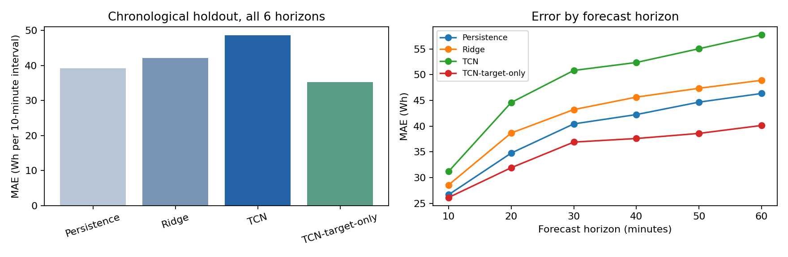

# Energy Forecast Lab

建筑能耗多步预测学习项目：使用过去 6 小时的观测，预测未来 1 小时内 6 个 10 分钟区间的用电量。

本项目包含 PyTorch 因果 TCN、持续性预测和 Ridge 基线、单变量消融、按时间划分的数据流水线、CPU 训练、可追溯实验报告及 FastAPI 预测接口。它是基于公开数据完成的个人学习原型。

## 快速运行

建议 Python 3.10 至 3.12。以下命令在仓库根目录执行。

```bash
python -m venv .venv
# Windows PowerShell
.venv\Scripts\Activate.ps1
# macOS/Linux: source .venv/bin/activate
python -m pip install -r requirements.txt
python -m pytest -q
python -m energy_forecast.data
python -m energy_forecast.train --epochs 20 --seed 42
python -m energy_forecast.inference --input examples/request.json
python -m uvicorn energy_forecast.api:app --host 127.0.0.1 --port 8000
```

不需要 GPU。Linux 机器可先从 PyTorch 官方 CPU 索引安装 `torch==2.5.1`，再安装 requirements，减少下载量。数据下载需要网络；测试使用人工构造的离线样本，测试结果与公开数据实验结果分别记录。

浏览器访问 `http://127.0.0.1:8000/docs` 查看接口，使用 `POST /forecast`，请求内容参考 `examples/request.json`。每条历史记录包含 `date`、`Appliances` 和传感器列；小时和星期的四个周期特征由服务生成。使用 `GET /schema` 获取所需字段，`GET /health` 检查模型状态。缺少模型返回 503，历史长度或数值不合法返回 422。

## 评估方法

- 输入长度 36，输出长度 6，步长 10 分钟；输入只使用预测时刻以前的记录。
- 原始行按 70% / 15% / 15% 顺序划分，目标跨越分界点的窗口丢弃。
- 标准化器仅在训练区间拟合；Ridge 的 alpha 和 TCN 的 epoch 仅用验证集选择。
- TCN 使用 dilation=1/2/4/8 的因果卷积残差块，以持续性预测为初始值，学习未来能耗变化。
- 对照持续性预测、Ridge、多变量 TCN 和只输入过去能耗的 TCN 消融模型。
- 报告 MAE、RMSE、sMAPE 和各预测步的误差，保存数据 SHA256、配置、训练日志及逐点预测。
- 所有模型都使用滚动预测协议：每个预测时刻可以使用新观测到的真实历史，不能将结果解释为不接收新观测的长期递归预测。

## 目录

```text
energy_forecast/data.py       数据下载、检查、特征和时间窗口
energy_forecast/model.py      因果卷积及 TCN
energy_forecast/train.py      基线、训练、早停、消融及报告
energy_forecast/inference.py  检查点加载及命令行预测
energy_forecast/api.py        FastAPI 接口
tests/                       泄漏边界、因果性、接口及训练集成测试
reports/                     实际实验结果及图表
examples/request.json        公开数据的请求示例
docs/interview_notes.md       原理讲解和亲自复现清单
DATA_CARD.md                 数据出处、许可和应用边界
```

数据来自 [UCI Appliances Energy Prediction](https://archive.ics.uci.edu/dataset/374/appliances-energy-prediction)，许可 CC BY 4.0；代码许可 MIT。数据集来自单栋住宅，不代表城市电网负荷，也没有真实节能或生产部署验证。更详细的限制见 [DATA_CARD.md](DATA_CARD.md)。

## 参考实验结果

以下是本项目实际 CPU 运行的单种子结果。单位为每个 10 分钟区间的 Wh，所有 6 个预测步汇总。

| 模型 | 测试 MAE | 测试 RMSE | 测试 sMAPE |
|---|---:|---:|---:|
| Persistence | 39.19 | 92.29 | 26.27% |
| Ridge | 42.06 | 76.24 | 35.71% |
| TCN | 48.63 | 78.18 | 41.11% |
| TCN-target-only | 35.21 | 73.95 | 28.39% |



本次 seed=42，epoch 上限=20，CPU 总运行时间 42.1 秒。
结果详情见 [results.json](reports/results.json)，训练日志见 [training_log.json](reports/training_log.json)。
当前仅有单随机种子和一个时间留出区间，不声称统计显著性或跨建筑泛化能力。多变量 TCN 未在测试 MAE 上超过基线，指标差异详见 [实验分析](reports/analysis.md)。

### 不训练直接试用参考模型

仓库提供与此报告对应的 `checkpoints/reference_tcn.pt`。安装依赖后，可执行：

```bash
python -m energy_forecast.inference --checkpoint checkpoints/reference_tcn.pt --input examples/request.json
```

启动接口时指定 `ENERGY_CHECKPOINT=checkpoints/reference_tcn.pt` 环境变量。参考权重来自公开数据，不包含私人数据。

`checkpoints/reference_target_only.pt` 是单变量对照权重；可将其传入相同的 `--checkpoint` 参数进行比较。对应接口仅需历史 `date` 与 `Appliances`。
